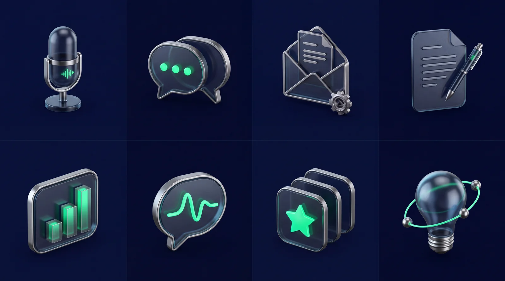
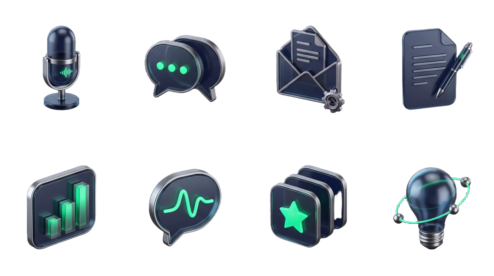

# Объёмные иконки AIHUB Store

Дата: 15.10.2026. Провайдер: LaoZhang Image Lab Clean / laozhang.ai.
Запрошенная и подтверждённая модель: `gemini-nano-banana-2.1` (Nano Banana 2.1).
Один платный запрос, без повторов и переключения модели; референсы не использовались.
Image ID: `5bb4153c-fc0c-4bf7-85f6-b9ae603dbe7b`.
Запрошены 4K / 16:9; фактические размеры и SHA-256 записаны в [манифесте](shop-icons-manifest.json).



Общая стилистика: тёмное стекло, полированный металл, зелёные световые детали,
трёхчетвертной ракурс. Каждая иконка представляет отдельное решение каталога.
Сохранены темы и порядок исходного магазина: голос, чат, заказы из почты,
документы, KPI, тональность, рекомендации, воркшоп.

У исходного листа видны фоновые подложки. Для использования в интерфейсе фон
удалён одним запросом Bria RMBG через тот же плагин; модель самой генерации
не менялась. Результат Bria: `51be7937-fd0e-4911-b366-79d965f7f064`.
Первое обращение по image_id было отклонено локальной валидацией без результата;
принят WebP data URI, подготовленный из оригинала (ширина 4096 px, quality 95).
SHA входа Bria и финальных вырезок находятся в манифесте.
Повторных платных генераций не выполнялось.

Финальные WebP имеют альфа-канал и не требуют blend-mode. Исходный PNG и
результат Bria сохранены отдельно, а не перезаписаны. Тонкие разделители листа
исключены при обрезке отдельных изображений.



Оптимизированные иконки: `public/shop/icons/*.webp`, по 640 × 640 px.
Оригинальный PNG сохранён локально в `tmp/shop-art/nano-banana-2.1-icons-v1.png`,
результат удаления фона — `tmp/shop-art/icons-bria-v1.png`, ранние вырезки —
`tmp/shop-art/icons-with-background-v1/` (папка игнорируется Git).
Компактные листы и манифесты обеих стадий входят в репозиторий.
Обработка выполняется `scripts/prepare-shop-icons.mjs`; нужен внешний пакет `sharp`,
не являющийся зависимостью сайта. Скрипт не перезаписывает существующие иконки.
Новая генерация является отдельным платным запросом, не частью обычной сборки.

## Точный запрос

```text
Create a premium cohesive collection of EIGHT dimensional 3D icons for the AIHUB AI solutions store. Output one precise 4-column by 2-row contact sheet in a 16:9 canvas. Eight equal invisible cells; one icon exactly centered inside each cell. No drawn cell boundaries, no labels, no lettering, no digits, no watermarks. Keep generous empty padding: each object and its shadow must fit within the central 65% of its cell width and 65% of its cell height, so each cell can be cropped separately.

Art direction: sophisticated product-design CGI, smoked midnight glass bodies with sculpted polished titanium/chrome edges, restrained luminous emerald green #08D070 interior details and a little cool cyan reflection. Background MUST remain perfectly flat deep midnight navy #060C24 everywhere; no horizon or ground plane. Soft directional studio lighting from upper left, dimensional bevels, smooth rounded geometry, plausible materials, light ambient shadow very close to each object. All eight use identical three-quarter view, scale, lighting and material vocabulary. Not cartoon mascots, not generic flat app icons. Each silhouette should be instantly legible at small size. Controlled glow only on the object, no big surrounding halos.

Exact order left to right:
Top row:
1. A premium upright microphone in a sculptural small circular stand, with emerald voice waveform detail: AI voice assistant.
2. Two interlocking rounded chat speech bubbles, front glass bubble with three luminous dots: AI chat assistant.
3. A sculpted open envelope with a small order-document tile emerging and a single small gear: email-to-order automation.
4. A rounded document slab with short embossed lines and a polished pen resting diagonally across it: automatic document filling.
Bottom row:
5. A rounded mini analytics dashboard slab with three emerald rising bars: KPI reporting.
6. A single glass chat bubble containing a luminous smooth pulse waveform, no face: customer sentiment monitoring.
7. Three neatly staggered rounded product tiles, one with a prominent emerald five-point star: personalized product recommendations.
8. A sculpted glass lightbulb with a small orbit of two connected metallic nodes: AI discovery workshop.

The eight SUBJECTS may differ, but palette, materials, camera, visual weight, object size and padding MUST remain unchanged throughout the set. This is a new image with no reference inputs.
```
